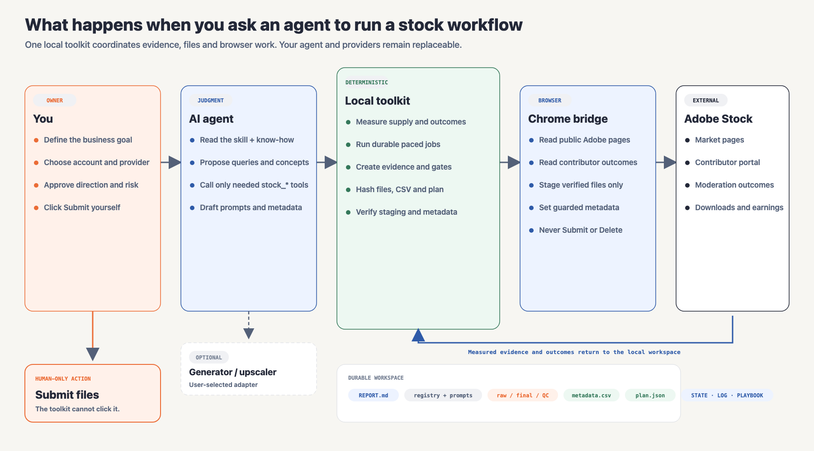
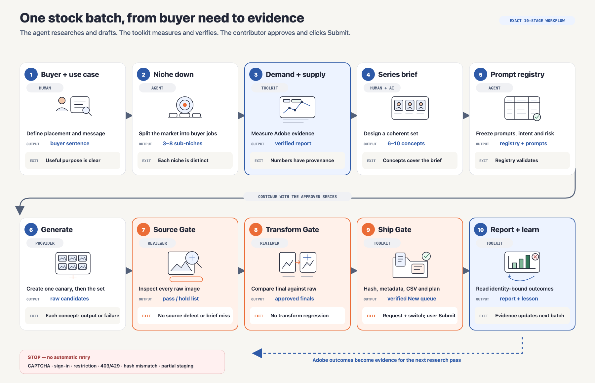
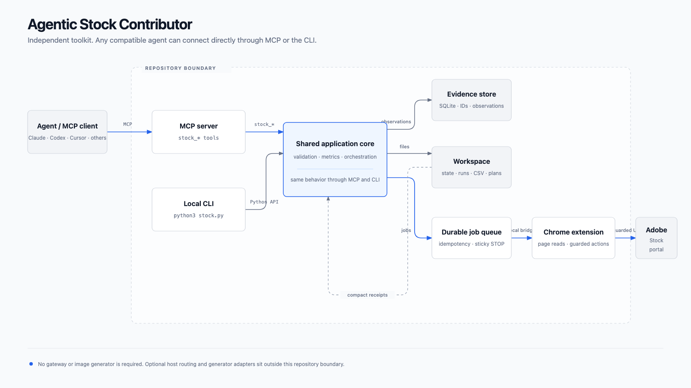

# Agentic Stock Contributor architecture

## Visual walkthrough

This generated illustration makes the journey easy to scan. It is conceptual: the labeled diagrams below define the exact stage names, gates and ownership boundaries. The contributor remains the only person who clicks Submit.

## Start here: who does what

This overview follows one request across the contributor, AI agent, local toolkit, Chrome bridge and Adobe Stock. It also shows the durable workspace and the human-only Submit action. The toolkit is independent of any specific agent host, MCP gateway, image generator or upscaler.

Required for the agent workflow:

1. Python 3.11 or newer.
2. Chrome 116 or newer.
3. An MCP-capable agent or client such as Claude Code, Codex, Cursor, LangGraph, OpenCode or another MCP client.
4. This repository, connected to the agent through its local MCP configuration.
5. The repository's Chrome extension, loaded unpacked and paired with the local server.
6. An Adobe Stock contributor account for portfolio, outcomes and staging. Public market research does not require login.

Pillow is optional and enables QC tile generation. Image generation and upscaling are bring-your-own capabilities; the workflow records the user's choice but does not require a named provider.

## Follow one batch through all ten stages

Each card shows the responsible role, the concrete output and the condition required to continue. Research numbers come from the toolkit, generation comes from the user's chosen provider, visual reviewers make QC decisions, and the toolkit packages only files that pass the recorded gates. Staging fills Adobe's New list only after explicit authorization and an enabled switch. The user clicks Submit.

## Implementation schematic

The editable sources are:

- [`system-overview.svg`](./system-overview.svg)
- [`production-workflow.svg`](./production-workflow.svg)
- [`agentic-stock-contributor.svg`](./agentic-stock-contributor.svg)

The explanatory diagrams are deterministic SVGs. Their labels, gates and boundaries use the repository's exact terminology and remain editable without regenerating artwork.

## Why `stock.py` exists

`stock.py` is an alternative interface to the same application core. It is useful for setup, diagnostics, repeatable local checks and scripts, but it is not an upstream dependency and it is not required in the main agent-to-MCP runtime flow. The overview therefore omits it from the primary path.

## Host infrastructure is separate

A machine may optionally place an MCP gateway in front of this server. The repository neither installs nor requires one. Image generators and upscalers connect through user-selected adapters and remain outside the toolkit.
